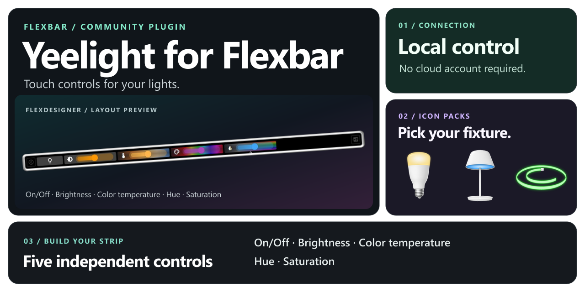
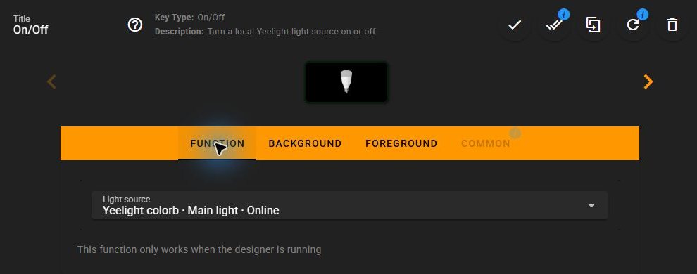
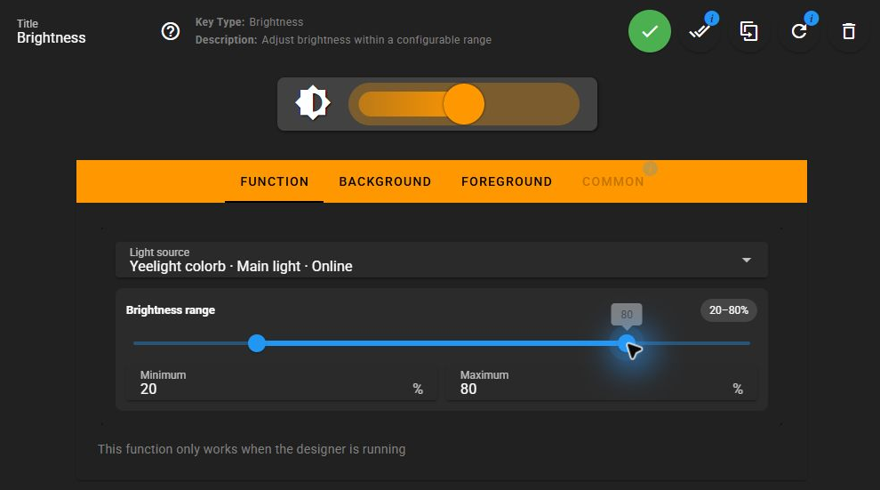
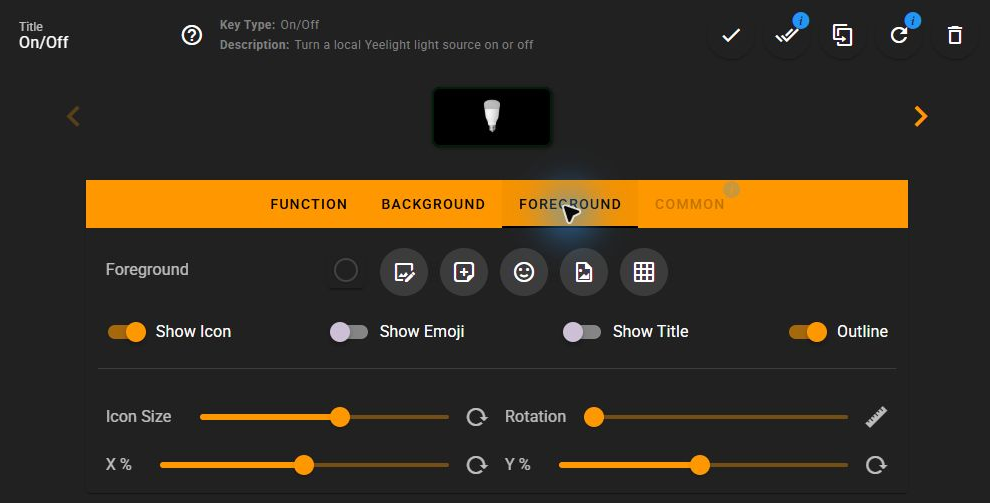

# Yeelight para Flexbar

[English](README.md) · [Русский](README.ru.md) · **Español** · [简体中文](README.zh-CN.md)



Controla las luces Yeelight desde Flexbar a través de tu red local. El complemento no utiliza Yeelight Cloud ni necesita conexión a Internet durante su uso.

**Primeros pasos:** [Instalación y configuración de la red local (en inglés)](docs/SETUP.md) · [Paquetes de iconos](#icon-packs) · [Compatibilidad](#requirements)

Puedes descargar el complemento, los dos paquetes opcionales de iconos y las sumas de verificación SHA-256 desde la [versión v0.1.0 en GitHub](https://github.com/mor4ee/yeelight-for-flexbar/releases/tag/v0.1.0).

## Configuración en FlexDesigner

**Elige una luz para cada control.** La pestaña **Function** solo muestra las fuentes de luz compatibles con ese control. En el ejemplo, el botón On/Off controla la luz principal.



**Ajusta el intervalo de brillo.** En el ejemplo, el deslizador aprovecha todo su recorrido: el extremo izquierdo corresponde al 20 % de brillo y el derecho al 80 %.



**Asigna un icono a cada estado.** Usa las flechas junto a la vista previa del botón para elegir Off u On. Después, abre **Foreground** para seleccionar el icono y ajustar su posición.



<a name="icon-packs"></a>

## Paquetes de iconos

Ambos paquetes son opcionales. Para importar un archivo `.iconpack` descargado, abre **Foreground → Icon pack → Import** en FlexDesigner. En el botón On/Off, selecciona cada estado con las flechas, asígnale su icono, aplica los cambios y carga la configuración en tu Flexbar.

- [Yeelight Vector Icon Pack](Icon_Pack/full/Yeelight%20Vector%20Icon%20Pack.iconpack) — 15 tipos de luminarias, cada uno con un icono blanco sobre fondo transparente para On y una versión tachada para Off.
- [Yeelight Color Icon Pack](Icon_Pack/color/Yeelight%20Color%20Icon%20Pack.iconpack) — 14 tipos de luminarias con seis variantes cada uno: apagada, cuatro colores de luz uniformes y un degradado Multicolor. El resplandor se aprecia mejor sobre un fondo oscuro.

[Galería de iconos vectoriales](.marketplace/vector-preview.png) · [Galería de iconos en color](.marketplace/color-preview.png)

Los iconos importados conservan sus colores; el selector de color de Foreground no los modifica. Este es un proyecto independiente de la comunidad, no un producto oficial de Yeelight.

## Funciones

- Detección automática por multidifusión, similar a SSDP, y registro manual mediante una dirección IPv4 local.
- La luz principal y la ambiental se pueden controlar por separado. Los controles comparten un único controlador por dispositivo físico.
- Cinco controles independientes: encendido y apagado, brillo, temperatura de color, tono y saturación.
- Sincronización del estado mediante notificaciones `props` y, cuando es necesario, consultas específicas con `get_prop`.
- Reconexión con intervalos de espera crecientes tras una suspensión, una interrupción de red o un cambio de dirección por DHCP.
- Puede funcionar junto con Yeelight Station a través de su servicio local. Si no está disponible, se conecta directamente por la red local.
- Solo se permiten comandos predefinidos del protocolo LAN de Yeelight.

<a name="requirements"></a>

## Requisitos

- Un Flexbar compatible y FlexDesigner con Plugin API v1. La versión de referencia verificada es la 2.2.3; la comprobación se limita a los escenarios probados.
- La compilación para Plugin API v1 se ha probado en Windows 10/11. Para el desarrollo se necesita Node.js 22.17 o posterior.
- Activa **LAN Control** en los dispositivos Yeelight. La red debe permitir conexiones TCP locales y tráfico UDP de multidifusión entre el ordenador y las luces.

El 30 de octubre de 2026 se encontró instalada la versión preliminar 2.2.5 de FlexDesigner, pero su compatibilidad con Yeelight aún no se ha verificado en el equipo físico. Quedan por probar los estados y deslizadores nativos, Apply en el editor, las actualizaciones de páginas, paneles desplegables y barras fijas, la carga con Upload y la reconexión. Esta revisión no implicó cambios en el SDK, la API ni el código del complemento.

## Compilar desde el código fuente

Con Node.js 22.17 o posterior y npm, ejecuta estos comandos desde la raíz del repositorio:

```sh
npm ci
npm run typecheck
npm test
npm run build
npm run validate
npm run pack
```

La compilación usa dependencias públicas de npm. No requiere instalar FlexDesigner, conectar luces ni disponer de un SDK privado o de proyectos en carpetas adyacentes. Instala el archivo `.flexplugin` resultante con FlexDesigner. No empaquetes una copia de desarrollo vinculada que contenga datos de dispositivos detectados.

[Configuración](docs/SETUP.md) · [Cómo contribuir](CONTRIBUTING.md) · [Notificar una vulnerabilidad](SECURITY.md) (en inglés).

## Privacidad y uso de la red

El complemento solo se comunica con direcciones IPv4 privadas o locales, detectadas automáticamente o introducidas por el usuario. No envía telemetría, credenciales, estados ni comandos a la nube. El acceso a la red se limita a la detección por UDP, la comunicación con el servicio local de Station y el control de Yeelight por TCP.

## Licencia

El código del complemento se distribuye bajo la [licencia MIT](LICENSE). La marca Yeelight identifica la integración y no está cubierta por esa licencia.
