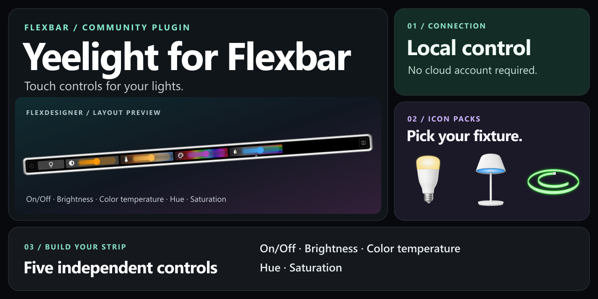
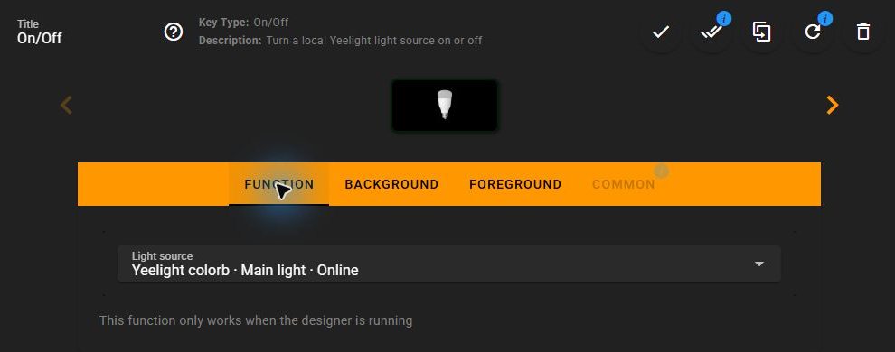
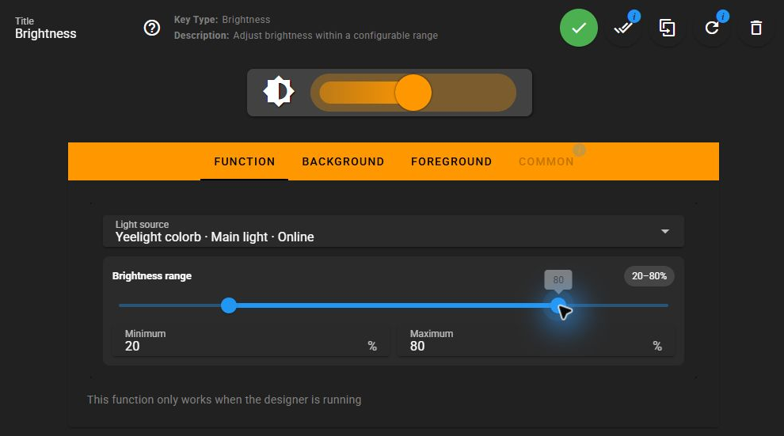
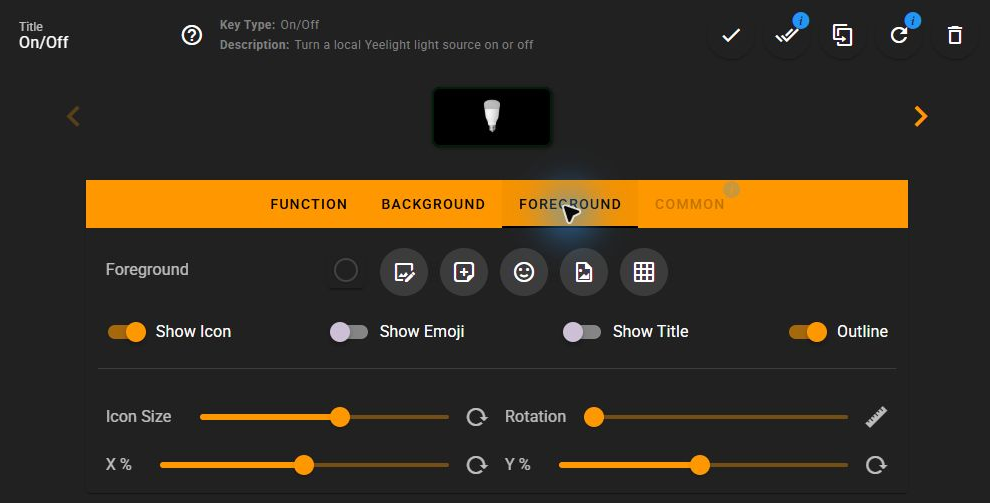

# Yeelight for Flexbar



Control Yeelight lights from Flexbar directly over the local network.
The plugin does not use Yeelight Cloud and does not require Internet access
at runtime.

**Start here:** [Installation and LAN setup](docs/SETUP.md) ·
[Optional icon packs](#optional-icon-packs) · [Compatibility](#requirements).
Download the plugin, optional icon packs and SHA-256 checksums from
[GitHub Release v0.1.0](https://github.com/mor4ee/yeelight-for-flexbar/releases/tag/v0.1.0).

## Inside FlexDesigner

**Choose a light for each control.** The Function tab lists sources compatible
with the selected control. Here an On/Off button is bound to a main light.



**Set the brightness range.** In this example, the full slider travel maps to
20–80% brightness on the selected light: the left end sets 20% and the right end sets 80%.



**Give each state its own icon.** Use the arrows beside the button preview to
select Off or On, then open Foreground to choose and position its artwork.



## Optional icon packs

The plugin works without either pack. Import a downloaded `.iconpack` from
**Foreground → Icon pack → Import** in FlexDesigner. For an On/Off control,
select each state with the arrows beside the preview, assign its icon in
Foreground, apply the changes and upload the layout to your Flexbar.

- [Yeelight Vector Icon Pack](Icon_Pack/full/Yeelight%20Vector%20Icon%20Pack.iconpack):
  15 fixtures, each with white On and crossed-out Off artwork on transparency.
- [Yeelight Color Icon Pack](Icon_Pack/color/Yeelight%20Color%20Icon%20Pack.iconpack):
  14 fixtures, each with Off and four glow colors. A dark background works best.

Preview the artwork: [Vector gallery](.marketplace/vector-preview.png) ·
[Color gallery](.marketplace/color-preview.png).

Imported artwork retains its own color; the native Foreground color picker
does not tint it. This is an independent community project, not an official
Yeelight product.

## Features

- automatic Yeelight discovery over SSDP-like multicast;
- manual registration by local IPv4 address;
- separate logical targets for main and background lights;
- independent Flexbar Units for Power, Brightness, Color Temperature, Hue,
  and Saturation;
- confirmed state synchronization through Yeelight `props` notifications and
  targeted `get_prop` fallback;
- reconnect with backoff after sleep, network interruption, or DHCP changes;
- coexistence with Yeelight Station through its loopback daemon, with direct
  LAN transports as fallback;
- one shared controller per physical device;
- local-only operation with a closed allowlist of Yeelight LAN commands.

## Requirements

- FlexDesigner Plugin API v1 and a compatible Flexbar; 2.2.3 is the verified
  workspace baseline, subject to the existing smoke-test limits above;
- Windows 10/11 for the currently tested Plugin API v1 build;
- Node.js 22.17 or newer for development;
- Yeelight devices with **LAN Control** enabled;
- the computer, Flexbar, and Yeelight devices on a network that allows local
  TCP and UDP multicast traffic.

FlexDesigner 2.2.5 Pre-release was found installed on 2026-10-30, but Yeelight
hardware compatibility on that version is pending. Retest native states and
sliders, editor Apply, page/drawer/fixed-bar updates, Upload and reconnect before
claiming support.
No SDK/API migration or plugin code change was made for that review.

## Build from source

Use Node.js 22.17 or newer and npm. From the repository root:

```sh
npm ci
npm run typecheck
npm test
npm run build
npm run validate
npm run pack
```

The build uses public npm dependencies. No FlexDesigner installation, connected
lights, private SDK or adjacent project is required to build. Install the
resulting `.flexplugin` through FlexDesigner to use it. Do not package a linked
development checkout containing discovered devices.

See [setup](docs/SETUP.md), [contributing](CONTRIBUTING.md) and
[security reporting](SECURITY.md).


## Privacy and network behavior

The plugin communicates only with private/local IPv4 addresses selected by
discovery or entered by the user. It does not send telemetry, account
credentials, device state, or commands to a cloud service.

Network access is required only for LAN UDP discovery, local Station IPC, and
Yeelight TCP control; it does not imply cloud connectivity.

## License

Plugin code is distributed under the [MIT License](LICENSE). The Yeelight
brand mark identifies the integration and is not covered by that license.
