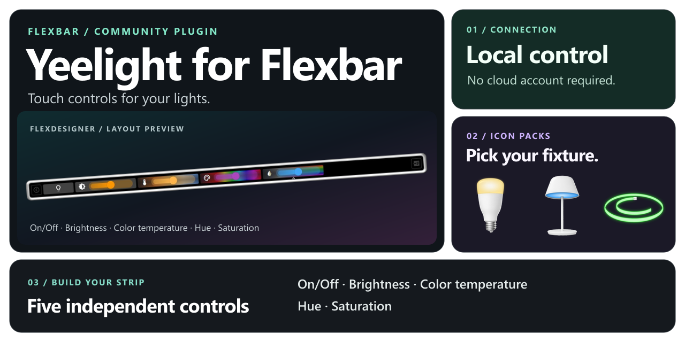
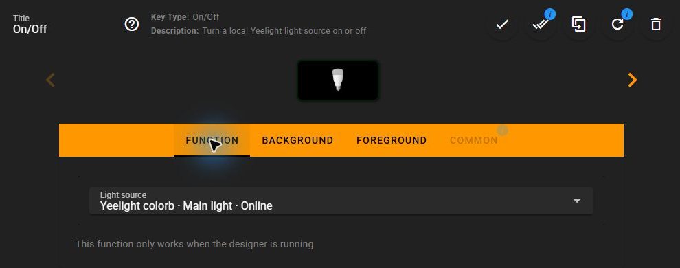
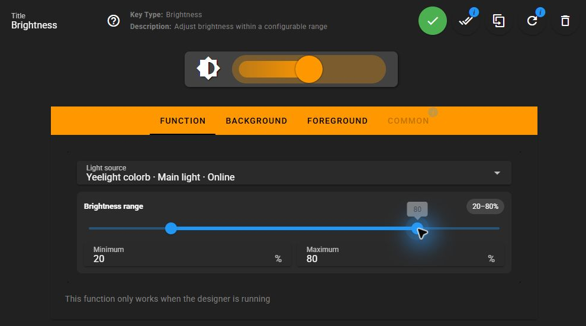
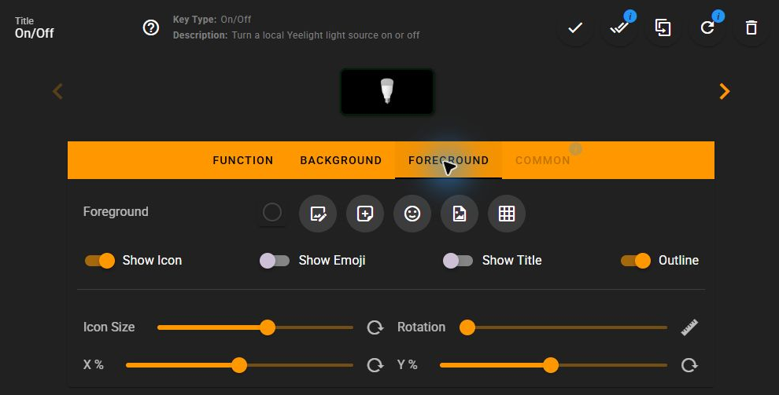
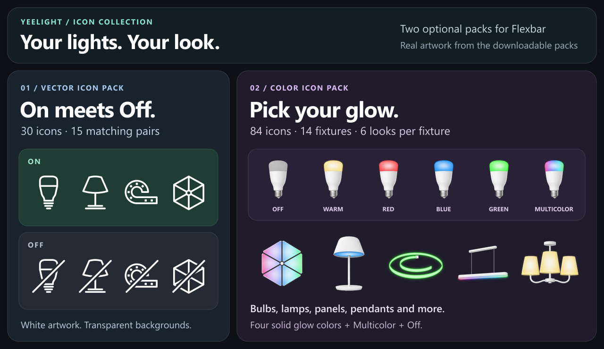

# Yeelight для Flexbar

[English](README.md) · **Русский** · [Español](README.es.md) · [简体中文](README.zh-CN.md)



Управляйте освещением Yeelight с панели Flexbar по локальной сети. Для работы плагина не нужны интернет и Yeelight Cloud.

**С чего начать:** [Установка и настройка LAN (на английском)](docs/SETUP.md) · [Наборы иконок](#icon-packs) · [Совместимость](#requirements)

Плагин, оба необязательных набора иконок и файл контрольных сумм SHA-256 можно скачать из [релиза v0.1.0 на GitHub](https://github.com/mor4ee/yeelight-for-flexbar/releases/tag/v0.1.0).

## Настройка в FlexDesigner

**Выберите светильник для каждого элемента.** На вкладке **Function** отображаются только источники света, которые поддерживают выбранную функцию. В примере кнопка On/Off управляет основным светом.



**Задайте диапазон яркости.** В примере ползунок использует всю длину дорожки: крайнее левое положение соответствует яркости 20 %, крайнее правое — 80 %.



**Назначьте иконку каждому состоянию.** Стрелками рядом с предпросмотром кнопки выберите Off или On. Затем на вкладке **Foreground** выберите иконку и настройте её положение.



<a name="icon-packs"></a>

## Наборы иконок

Плагин работает и без наборов иконок. Чтобы импортировать скачанный файл `.iconpack`, в FlexDesigner откройте **Foreground → Icon pack → Import**. Для кнопки On/Off назначьте иконку каждому состоянию отдельно, примените изменения и загрузите раскладку на Flexbar.



[Yeelight Vector Icon Pack](Icon_Pack/full/Yeelight%20Vector%20Icon%20Pack.iconpack) — 15 типов светильников. Для каждого — белая иконка на прозрачном фоне для On и перечёркнутая для Off.

[Yeelight Color Icon Pack](Icon_Pack/color/Yeelight%20Color%20Icon%20Pack.iconpack) — 14 типов светильников, по шесть вариантов для каждого: выключенный, четыре одноцветных свечения и градиент Multicolor. Свечение лучше видно на тёмном фоне.

Импортированные иконки сохраняют собственные цвета: палитра на вкладке Foreground их не перекрашивает. Это независимый проект сообщества, а не официальный продукт Yeelight.

## Возможности

- Автоматический поиск по локальной сети через многоадресные запросы, похожие на SSDP, и ручное добавление по IPv4-адресу.
- Основной свет и фоновая подсветка доступны как отдельные источники. Для каждого физического устройства используется один общий контроллер.
- Пять независимых элементов: включение/выключение, яркость, цветовая температура, оттенок и насыщенность.
- Состояние обновляется по уведомлениям `props`; при необходимости плагин запрашивает конкретные свойства командой `get_prop`.
- После сна, разрыва сети или смены адреса по DHCP плагин переподключается с увеличивающимся интервалом между попытками.
- Плагин может работать вместе с Yeelight Station через её локальную службу. Если этот путь недоступен, используется прямое соединение по LAN.
- Разрешены только заранее определённые команды локального протокола Yeelight.

<a name="requirements"></a>

## Требования

- Совместимая панель Flexbar и FlexDesigner с Plugin API v1. Базовая версия для проверок — 2.2.3; результаты относятся только к проверенным сценариям.
- Сборка Plugin API v1 проверялась на Windows 10/11. Для разработки нужен Node.js 22.17 или новее.
- На светильниках Yeelight должно быть включено **LAN Control**. Для работы нужны локальные TCP-соединения и многоадресный UDP-трафик между компьютером и светильниками.

30 октября 2026 года на рабочей машине была установлена FlexDesigner 2.2.5 Pre-release. Совместимость с Yeelight на оборудовании для этой версии ещё не подтверждена: нужно проверить состояния и ползунки, Apply в редакторе, обновление страниц, выдвижной и закреплённой панелей, Upload и переподключение. При этом обзоре SDK, API и код плагина не менялись.

## Сборка из исходников

Из корня репозитория выполните команды с Node.js 22.17 или новее и npm:

```sh
npm ci
npm run typecheck
npm test
npm run build
npm run validate
npm run pack
```

Для сборки достаточно публичных зависимостей npm. Установленный FlexDesigner, подключённые лампы, закрытый SDK и соседние проекты не нужны. Готовый `.flexplugin` установите через FlexDesigner. Не упаковывайте привязанную рабочую копию разработчика, если в ней сохранены обнаруженные устройства.

[Настройка](docs/SETUP.md) · [Участие в разработке](CONTRIBUTING.md) · [Как сообщить об уязвимости](SECURITY.md) (на английском).

## Конфиденциальность и сеть

Плагин обращается только к локальным IPv4-адресам, найденным при поиске или введённым вручную. Телеметрия, учётные данные, состояния устройств и команды не отправляются в облако. Сеть используется для поиска по UDP, связи с локальной службой Station и управления светом по TCP.

## Лицензия

Код плагина распространяется по [лицензии MIT](LICENSE). Знак Yeelight обозначает интеграцию и этой лицензией не покрывается.
