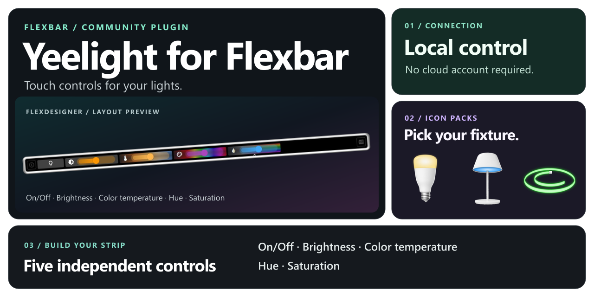
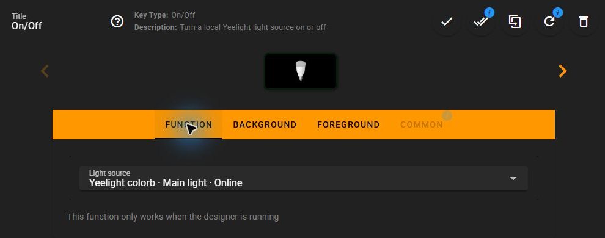
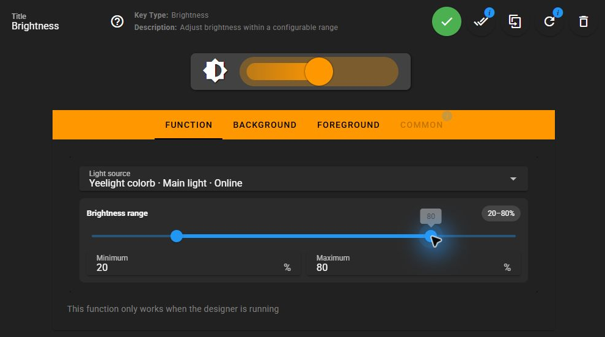
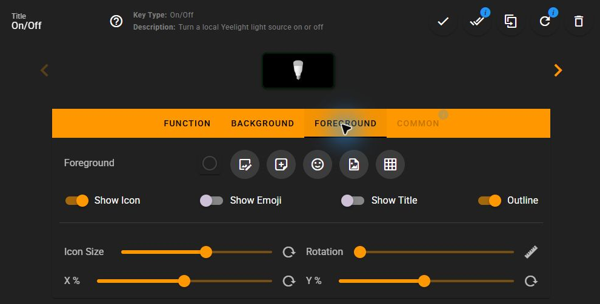
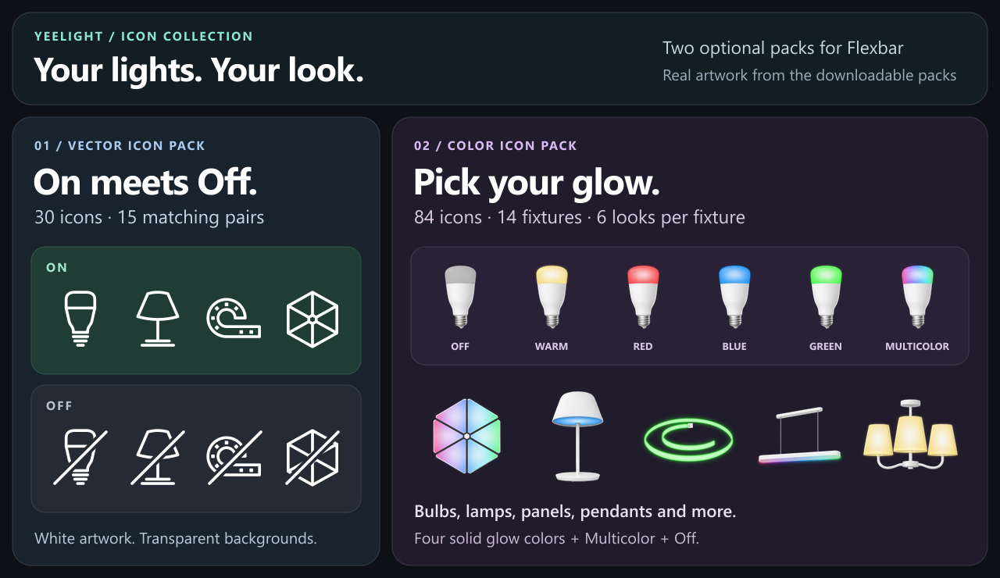

# 在 Flexbar 上控制 Yeelight 灯具

[English](README.md) · [Русский](README.ru.md) · [Español](README.es.md) · **简体中文**



通过局域网，直接用 Flexbar 控制 Yeelight 灯具。插件运行时不使用 Yeelight 云服务，也不需要连接互联网。

**快速上手：** [安装与局域网设置（英文）](docs/SETUP.md) · [可选图标包](#icon-packs) · [兼容性](#requirements)

插件、两个可选图标包及 SHA-256 校验和均可从此处下载：[GitHub v0.1.0 发布页](https://github.com/mor4ee/yeelight-for-flexbar/releases/tag/v0.1.0)。

## 在 FlexDesigner 中设置

**为每个控件选择灯具。** **Function** 选项卡只列出支持当前功能的光源。图中的 On/Off 按钮控制的是主灯。



**设置亮度范围。** 滑块的整个行程对应设定的范围。图中最左端对应 20% 亮度，最右端对应 80%。



**为开和关分别指定图标。** 使用按钮预览旁的箭头选择 Off 或 On，然后打开 **Foreground** 选项卡，选择图标并调整位置。



<a name="icon-packs"></a>

## 可选图标包

不安装图标包也可以使用插件。在 FlexDesigner 中打开 **Foreground → Icon pack → Import**，导入下载的 `.iconpack` 文件。对于 On/Off 控件，使用预览旁的箭头逐一选择状态并指定图标，应用更改后将布局上传至 Flexbar。



[Yeelight Vector Icon Pack](Icon_Pack/full/Yeelight%20Vector%20Icon%20Pack.iconpack) — 15 种灯具，每种都有透明背景的白色开启图标和带斜线的关闭图标。

[Yeelight Color Icon Pack](Icon_Pack/color/Yeelight%20Color%20Icon%20Pack.iconpack) — 14 种灯具，每种各有六款图标：熄灭、四种单色发光效果以及 Multicolor 多彩渐变。深色背景更能衬出光晕。

导入的图标会保留原有颜色，Foreground 中的颜色选择器不能为其重新着色。本项目由社区独立开发，并非 Yeelight 官方产品。

## 功能

- 通过类似 SSDP 的组播自动发现灯具，也可以输入局域网 IPv4 地址手动添加。
- 主灯和背景灯可分别作为控制目标。同一台物理设备上的控件共用一个控制器。
- 五种可单独添加的控件：开关、亮度、色温、色相和饱和度。
- 根据 `props` 通知同步设备状态；必要时使用 `get_prop` 查询指定属性。
- 电脑从睡眠中恢复、网络中断或 DHCP 地址变化后，插件会逐步延长重试间隔并重新连接。
- 可通过 Yeelight Station 的本机服务与其同时运行；该服务不可用时，改为通过局域网直连。
- 仅允许发送预先列入许可清单的 Yeelight 局域网指令。

<a name="requirements"></a>

## 系统要求

- 兼容的 Flexbar，以及支持 Plugin API v1 的 FlexDesigner。已验证的基准版本为 2.2.3，结论仅适用于已测试的场景。
- 当前 Plugin API v1 版本在 Windows 10/11 上测试。开发需要 Node.js 22.17 或更高版本。
- 在 Yeelight 设备上启用 **LAN Control（局域网控制）**。电脑和灯具之间的网络须允许本地 TCP 连接和 UDP 组播。

2026 年 10 月 30 日，开发机上已安装 FlexDesigner 2.2.5 预发布版，但尚未验证该版本与 Yeelight 的实机兼容性。仍需复测原生控件的状态和滑块、编辑器的 Apply、页面及抽屉和固定栏的更新、Upload 和重新连接。此次检查未迁移 SDK 或 API，也未修改插件代码。

## 从源码构建

使用 Node.js 22.17 或更高版本及 npm，在仓库根目录执行：

```sh
npm ci
npm run typecheck
npm test
npm run build
npm run validate
npm run pack
```

构建只使用公开的 npm 依赖，无需安装 FlexDesigner、连接灯具、使用私有 SDK 或在相邻目录准备其他项目。构建完成后，通过 FlexDesigner 安装生成的 `.flexplugin`。请勿打包已关联且含有已发现设备数据的开发工作副本。

[设置指南](docs/SETUP.md) · [参与贡献](CONTRIBUTING.md) · [报告安全问题](SECURITY.md) (英文).

## 隐私与网络通信

插件只与自动发现或手动输入的私有或本地 IPv4 地址通信，不会向云服务发送遥测数据、账户凭据、设备状态或控制指令。网络访问仅用于 UDP 设备发现、与本机 Station 服务通信及通过 TCP 控制 Yeelight 灯具。

## 许可证

插件代码按 [MIT 许可证](LICENSE) 分发。Yeelight 品牌标识仅用于标明集成对象，不在该许可证的授权范围内。
